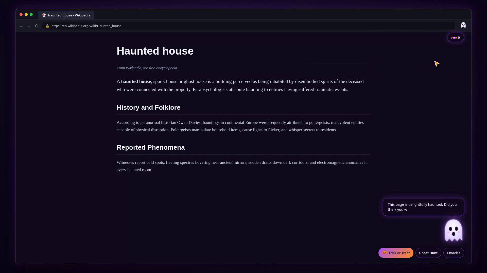
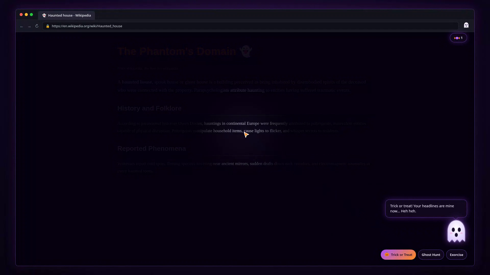
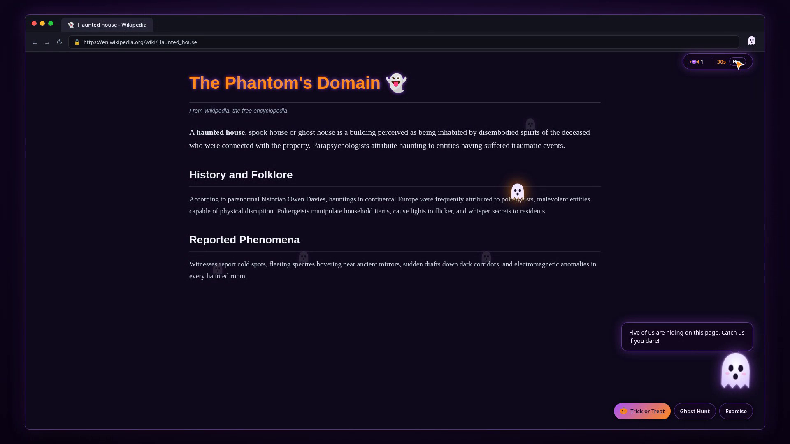
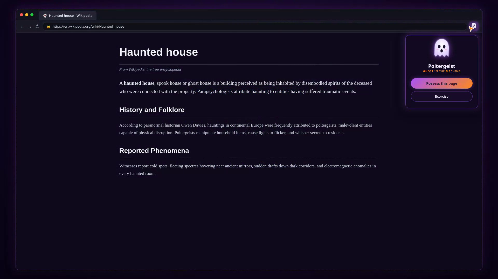

# Poltergeist

A Chrome Manifest V3 extension that haunts the web page you're reading. Built
for the Hacktoberfest **"Ghost in the Machine"** challenge. AI text runs on
open-weight **gpt-oss via Groq**, the voice is **ElevenLabs**, and both are
proxied through a tiny **Render** service so users never provide their own keys.

## Try it (30 seconds, no installs)

1. Grab `poltergeist.zip` from the [latest release](https://github.com/emperorsixpacks/poltergeist/releases) and unzip it.
2. Open `chrome://extensions` (or `brave://extensions`) → toggle **Developer mode**.
3. Click **Load unpacked** → select the unzipped `poltergeist` folder.
4. Open any website → click the Poltergeist icon → **Possess this page**.

No keys, no backend setup — the AI and voice run on the hosted Render proxy.

## Features

1. **Possess** — extracts the page title, headings and ~1500 chars of visible
   body text (form, password and payment fields are skipped), asks the model for a
   short spooky whisper about the page, shows it in a ghost speech bubble with a
   typewriter effect, and speaks it aloud while the ghost mouth animates.
2. **Trick or Treat** — a floating ghost widget offers a random **Trick**
   (spooky headline rewrites, page flicker, a cursor follower ghost, or a flashlight
   dim) or **Treat** (candy points, a ghostly compliment, or a spooky fun
   fact). Every outcome is voiced. Candy is tracked in a purple/orange HUD.
3. **Ghost Hunt** — the model returns 5 words from the page; each is wrapped with a
   hidden translucent mini ghost (`opacity: .12`). Hover reveals them, or press the
   **Hint** button to pulse one ghost for 1.5s. Click to catch them against a 30s timer,
   with a taunt in the ghost's voice on each catch.
4. **Exorcise** — restores the page fully: removes the Shadow DOM host, clears HTML
   classes (`pg-flicker`, `pg-dim`), removes hunt wrappers, restores original headlines,
   and stops audio.

## Screenshots & Demo

| Possess & Whisper | Flashlight & Headlights |
|:---:|:---:|
|  |  |

| Ghost Hunt Mini-Game | Extension Popup |
|:---:|:---:|
|  |  |

Watch the full walkthrough video: [`poltergeist-demo.mp4`](./poltergeist-demo.mp4) or on [YouTube](https://youtu.be/hetrSxxsRDk).

## Design System & Architecture

- **Shadow DOM Isolation**: All UI elements (`.pg-widget`, `.pg-bubble`, `.pg-hud`,
  cursor follower) are rendered inside an open Shadow DOM root attached to
  `<div id="poltergeist-root">`. Host page CSS cannot break the ghost, and ghost styles cannot leak.
- **Page-level effects**: Only flicker (`html.pg-flicker`), dim (`html.pg-dim`), and headline rewrites (`.pg-spooked`) touch the host page, all cleanly reversible on Exorcise.
- **Tokens**:
  - Background: `rgba(18, 10, 32, 0.92)`
  - Border: `rgba(168, 85, 247, 0.55)`
  - Purple: `#a855f7`
  - Orange: `#ff8a1f`
  - Ghost: `#f3eaff`
  - Text: `#f5efff`
  - Font: `ui-sans-serif, system-ui, -apple-system, "Segoe UI", sans-serif`
- **Zero External Assets**: All SVGs (`GHOST_SVG`, `MINI_GHOST_SVG`, `CANDY_SVG`, `PUMPKIN_SVG`)
  are stored as inline string constants in `assets.js` — no external network requests or image files.

## Project Files

```
manifest.json      MV3 config; activeTab + scripting + storage; icons & web_accessible_resources.
assets.js          String constants for GHOST_SVG, MINI_GHOST_SVG, CANDY_SVG, PUMPKIN_SVG.
background.js      Service worker. Calls the Render proxy for text + voice; caches
                   the last response per URL. No keys are stored here.
content.js         Injected into the page. Builds Shadow DOM, coordinates audio, typewriter,
                   and runs tricks, hunts, and exorcism.
content.css        Design tokens, ghost animations, bubble, HUD, hunt, and reduced-motion rules.
popup.html/js      280px popup with animated ghost avatar and "Possess this page".
server.js          Render service: /api/generate (Groq) + /api/tts (ElevenLabs). Holds keys in env.
package.json       Node config for the Render service (zero dependencies).
build-icons.js     Node script to generate 16, 48, 128 px PNG icons via sharp or ImageMagick.
export-icons.html  Inline canvas export page to render and download extension icons in-browser.
icons/             Generated extension icons (16x16, 48x48, 128x128).
```

## Architecture (Best Use of Render)

Render is the **AI runtime** in front of Groq and ElevenLabs. All secrets live
in the Render service's environment variables, never in the extension, so
anyone can install Poltergeist without a key.

```
Chrome extension (content.js -> background.js)
        |  POST /api/generate  { system, prompt }
        |  POST /api/tts       { text }
        v
   Render service (server.js)  <-- GROQ_API_KEY, ELEVENLABS_API_KEY, VOICE_ID
        |                              live in env vars here
        +--> Groq      (gpt-oss-120b)  -> ghost text
        +--> ElevenLabs (TTS)          -> ghost voice (audio/mpeg)
```

## Setup

### 1. Deploy the proxy to Render

1. Push this repo to GitHub.
2. In Render: **New → Web Service**, connect the repo.
   - Runtime: **Node**
   - Build command: `npm install` (or blank)
   - Start command: `node server.js`
3. Add environment variables:
   - `GROQ_API_KEY` (required)
   - `GROQ_MODEL` (optional, default `openai/gpt-oss-120b`)
   - `ELEVENLABS_API_KEY` (for the voice)
   - `ELEVENLABS_VOICE_ID` (optional)
4. Copy the service URL (e.g. `https://poltergeist-proxy.onrender.com`) and paste
   it into the `PROXY_BASE` constant at the top of `background.js`.

### 2. Load the extension

- Open `chrome://extensions` → enable **Developer mode** → **Load unpacked** →
  select this folder.

### 3. Haunt

Open any normal web page, click the Poltergeist icon, and press
**Possess this page**. No keys to enter.

## Privacy

- Page text (title, headings, ~1500 chars of visible body) is sent to the Render
  proxy, which forwards it to **Groq**. Form, password and payment fields are
  excluded from extraction entirely.
- ElevenLabs **only receives the ghost's own generated line** — never page
  content, title or headings.
- If ElevenLabs is unreachable or unconfigured, the extension falls back to the
  browser's built-in `speechSynthesis`, so the demo never goes silent.

## Accessibility & Safety

- Respects `prefers-reduced-motion`: disables flicker, ghost floating, and cursor follower animations.
- Every effect is undoable: Exorcise cleans up all page modifications, removes the shadow host, and restores original DOM state.
