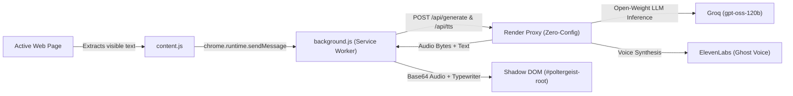

*This is a submission for the [Hacktoberfest Open-Source AI Challenge Week 4: Ghost in the Machine](https://dev.to/challenges/hacktoberfest-week4-2026-10-26)*

> **Try it now** — [watch the demo](https://youtu.be/hetrSxxsRDk), then [grab the extension](https://github.com/emperorsixpacks/poltergeist/releases). No installs, no API keys.

## What I Built

**Poltergeist** is a Chrome Manifest V3 extension that literally haunts whatever web page you are reading.

Most AI browser extensions behave like polite corporate sidebars: you highlight text, click a button, and read a summary in a neat little drawer. **Poltergeist does the exact opposite.** It treats your browser as a physical, haunted environment.

When you click **Possess this page**, a purple-glowing ghost materializes directly over your screen. It reads the page's title, headings, and visible text, then whispers an eerie, hilarious, context-aware observation about *that exact page* in a floating speech bubble — spoken aloud with an authentic spectral voice while its mouth animates.



### Features & Capabilities

Poltergeist doesn't stop at a single whisper. It comes packed with a full suite of mischievous interactions:

- 👻 **Possess**: Scans the page text (excluding sensitive inputs) and speaks an eerie, hyper-specific whisper with real-time typewriter text and an animated talking mouth.
- 🎃 **Trick or Treat**: An interactive Halloween button powered by a candy economy:
  - **Treats**: Awards candy points into a glowing HUD, speaks eerie compliments (*"This page is positively boo-tiful"*), or delivers creepy fun facts.
  - **Tricks**:
    - **Spooky Headline Mutation**: Dynamically rewrites the page's headings into chilling alternatives with a glowing orange aesthetic (`.pg-spooked`).
    - **Screen Flicker**: Glitches the entire webpage body via CSS hue-rotation and vibration (`html.pg-flicker body`).
    - **Flashlight Mode**: Plunges the entire webpage into pitch darkness, revealing only a circular spotlight beam that dynamically tracks your mouse cursor (`html.pg-dim::before`).
    - **Cursor Follower**: Spawns a mini ghost that lerps smoothly behind your cursor, flipping horizontally based on movement direction.
- 🎯 **Ghost Hunt**: An interactive mini-game. The open-weight model picks 5 words from the page text to hide in. Mini ghosts are embedded directly into the text at `opacity: .12` (barely visible). A 30-second countdown timer starts in the HUD. You can hover to reveal them or click the **Hint** button to pulse an uncaught ghost. Catching a ghost triggers a poof vanish animation (`pg-vanish`), a voiced taunt, and +1 candy reward!
- ✝️ **Exorcise**: Absolute, clean reversibility. One click restores every mutated headline back to its original text (via `WeakMap`), unwraps all ghost hunt spans back to plain text nodes, removes HTML effect classes, silences audio, and unmounts the Shadow DOM root.

---

## Demo

- 📺 **Watch the Full Video Walkthrough**: [YouTube Demo](https://youtu.be/hetrSxxsRDk)
- 📁 **Repository Video**: [`poltergeist-demo.mp4`](./poltergeist-demo.mp4) (1080p 60fps walkthrough showcasing popup activation, possession, typewriter speech, headline mutation, flicker, flashlight mode, cursor follower, ghost hunt, and clean exorcism).

### Visual Walkthrough

#### 1. Summoning the Ghost (Popup UI)

*Clicking the extension icon opens the 280px popup with our dark design system, glowing SVG mascot, and one-click 'Possess this page' trigger.*

#### 2. The Haunting: Contextual Whisper & Typewriter Animation

*The ghost manifests inside an isolated Shadow DOM host (`#poltergeist-root`), typing out an in-character observation while its mouth animates in sync with ElevenLabs speech.*

#### 3. Trick or Treat: Spooky Headline Mutations & Screen Flicker

*Real page headings mutate into eerie alternatives with glowing orange text (`.pg-spooked`), while the page glitches via CSS animations.*

#### 4. Flashlight Mode: Dynamic Spotlight Tracking

*The page plunges into darkness with a circular spotlight beam (`html.pg-dim::before`) and mini ghost follower lerping behind your cursor.*

#### 5. Ghost Hunt: Interactive Hiding Game

*5 words are wrapped with translucent mini ghosts (`opacity: .12`). Hover to spot them, click the 'Hint' button to pulse an uncaught ghost, and catch them before the 30-second timer expires!*

#### 6. Architecture & Clean Reversibility

*Exorcise cleanses the DOM completely. Zero API keys in the client, 100% Shadow DOM isolation, and open-weight LLMs on Groq.*

---

## Code



### Core Repository Highlights

- **Zero Build Step / Zero Dependencies**: Pure vanilla JavaScript, standard CSS3, and native Chrome MV3 APIs. No npm install, no bundler, no framework overhead.
- **100% Shadow DOM Isolation**: All ghost UI elements (`.pg-widget`, `.pg-bubble`, `.pg-hud`, cursor follower) render inside an open Shadow DOM hosted at `
`. Host page CSS cannot break the ghost, and ghost CSS cannot leak onto the page.
- **Zero External Image Requests**: All visual assets (`GHOST_SVG`, `MINI_GHOST_SVG`, `CANDY_SVG`, `PUMPKIN_SVG`) are stored as inline SVG string constants in `assets.js`.

---

## How I Built It

### The AI Brain: Open-Weight gpt-oss-120b via Groq

Poltergeist is powered by **gpt-oss-120b**, OpenAI's open-weight model, served through **Groq** for sub-second inference speed.

The model acts as the ghost's subconscious. Through specialized system prompts, it receives sanitized text extracts and returns structured JSON responses for:
1. **Whispers**: Short, eerie, funny observations (max 25 words) grounded strictly in the page content.
2. **Headlines**: Rewriting existing page headings into spooky alternatives while preserving list order.
3. **Ghost Hunt Words**: Selecting 5 distinctive words that literally appear in the page text to serve as hiding spots.

### System Architecture

1. **Chrome Extension (Manifest V3)**:
   - **Service Worker (`background.js`)**: Coordinates API calls, caches the last generated response per URL (so repeat haunts on the same article are instant), and base64-encodes audio for injection.
   - **Content Script (`content.js` + `content.css` + `assets.js`)**: Extracts visible DOM text while strictly skipping sensitive elements (`INPUT`, `TEXTAREA`, `SELECT`, password fields, headers, and footers). Mounts the isolated Shadow DOM, coordinates typewriter rendering, animates the ghost's mouth during speech, and manages the undo stack.
   - **Popup (`popup.html` / `popup.js`)**: A sleek 280px popover adhering to our custom design system (`--pg-bg: #120a20`, `--pg-purple: #a855f7`, `--pg-orange: #ff8a1f`) with a floating ghost avatar and instant "Possess this page" button.

2. **Backend Proxy on Render (`server.js`)**:
   - A tiny, zero-dependency Node.js HTTP service hosted on Render (`poltergeist-proxy.onrender.com`).
   - Keeps the Groq and ElevenLabs API keys securely server-side.
   - **Zero Configuration for Users**: Anyone loading the extension unpacked in Developer Mode can use it immediately without pasting an API key or signing up for third-party services.

3. **Voice Engine & Accessibility**:
   - Voice generated using ElevenLabs' `eleven_multilingual_v2` model with a custom ghost voice ID.
   - **Graceful Fallback**: If network drops or voice credits expire, Poltergeist automatically falls back to the browser's native `window.speechSynthesis`.
   - **Accessibility**: Full `@media (prefers-reduced-motion: reduce)` compliance automatically disables screen flickering, ghost floating, and cursor followers while keeping static UI fully usable.

---

## Why Does Open Innovation Matter?

Open innovation is the entire reason Poltergeist exists.

1. **Model Sovereignty & Portability**: The ghost's personality is defined by an open-weight model and a prompt. We originally prototyped Poltergeist using a local Ollama instance running Gemma. When we transitioned to `gpt-oss-120b` via Groq for instant cloud latency, we didn't have to rewrite proprietary SDKs or accept vendor lock-in. Open weights let you swap the brain freely.
2. **Zero-Friction Distribution**: In closed AI ecosystems, building a browser extension usually means forcing users into subscription paywalls or asking them to paste private API keys into an options page. With open-weight models hosted on open infrastructure like Render, we can distribute a delightful, free tool that works out-of-the-box.
3. **Privacy & Trust**: Browser extensions have privileged access to what you read. With open architecture, users don't have to trust a black box. The code is completely unbundled and readable in plain JavaScript: anyone can inspect how text is extracted, verify that forms and passwords are never touched, and confirm that only the generated whisper is ever sent to the text-to-speech engine.
4. **Remixability**: Anyone can fork this repository, swap in Mistral, Llama 3, or DeepSeek, alter the ghost's personality from a Halloween poltergeist into an Elizabethan poet or an 80s cyberpunk hacker, and run it locally or on their own server.

---

## My Agent Session

This project was built and refined in collaboration with **Antigravity**, Google DeepMind's advanced coding assistant.

The agent session helped:
- Architect the **Shadow DOM isolation system** to guarantee that complex CSS animations (`@keyframes pg-float`, `@keyframes pg-talk`, `@keyframes pg-blink`) and design tokens never collide with the host page.
- Implement the **WeakMap reversibility engine** for headline mutations and text node wrapping during the Ghost Hunt.
- Build the automated **headless browser recording pipeline** using Playwright, Chromium, and FFmpeg to generate the full-resolution synchronized demo video with real ElevenLabs audio.

---

## The Spirit of It

The magic of Poltergeist lands in the unexpected moments.

When you open a dense, dry technical specification, a Wikipedia article on medieval architecture, or an obscure recipe blog, and press *Possess this page*, you don't get a generic canned Halloween sound effect. You hear a raspy, eerie whisper pointing out something absurdly specific from paragraph three that only someone reading along with you would notice.

It turns passive browsing into an interactive theatrical performance. That is the essence of **"Ghost in the Machine"**: open-weight AI stepping out of the terminal and making the web feel playful, mysterious, and alive.

---

## Prize Categories

- **Best Use of Render**: Zero-dependency Node.js proxy deployed on Render (`poltergeist-proxy`), enabling serverless key management and zero-configuration extension usage.
- **Best Use of Groq**: Ultra-low-latency inference using open-weight `gpt-oss-120b` on Groq, delivering sub-second ghost responses and real-time headline rewrites.
- **Best Use of ElevenLabs**: Dynamic text-to-speech synthesis using custom voice profiles, synced with SVG mouth animations and fallback speech synthesis.
